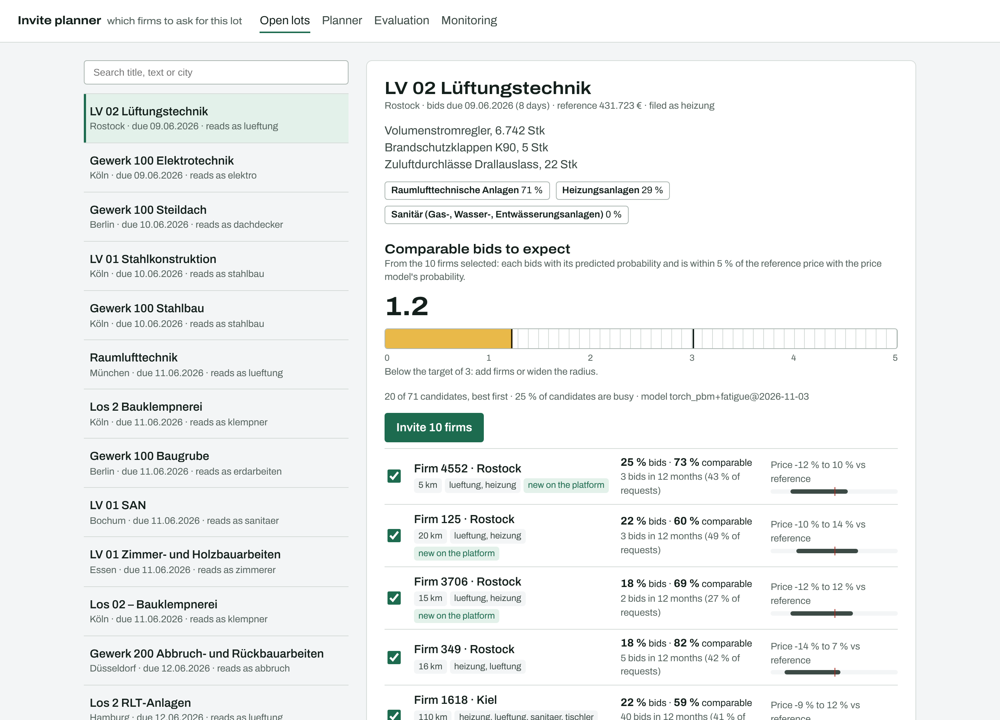
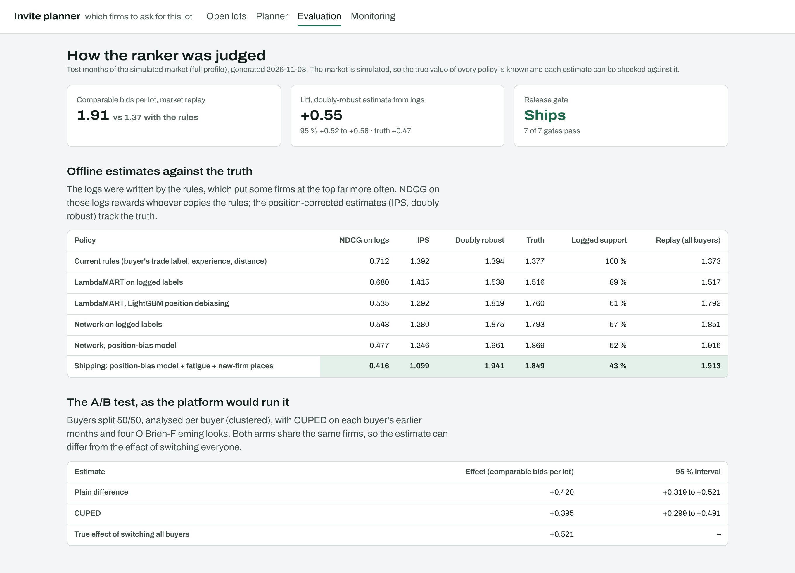
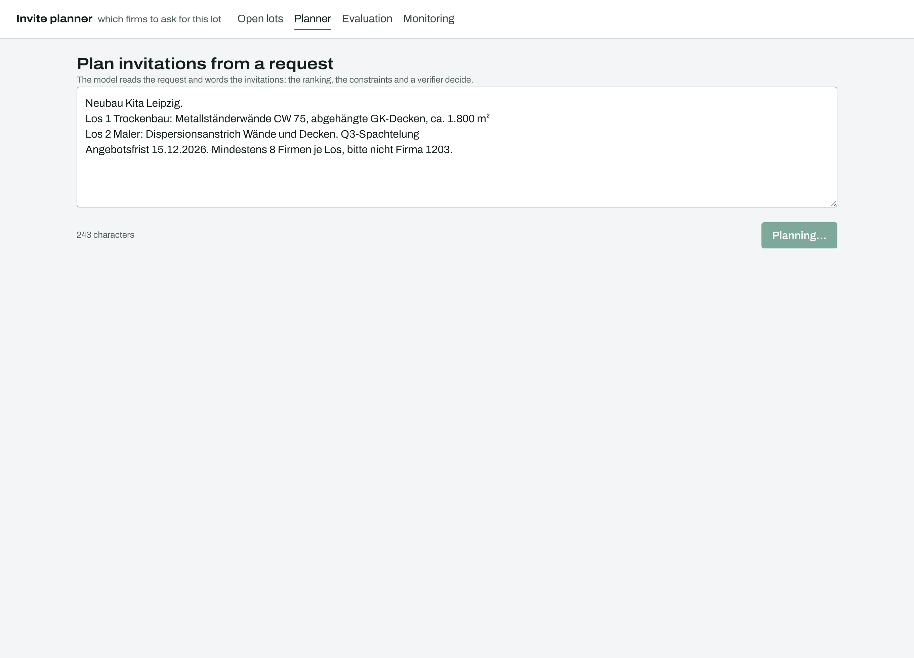
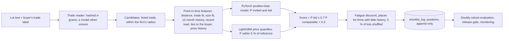

# tender-match-ranker

Which subcontractors should a buyer invite to a construction tender lot? This repository builds that ranking
end to end:

- a trade reader for German lot texts;
- learning to rank from biased logs, with PyTorch and LightGBM;
- a price-competitiveness model;
- off-policy evaluation, checked against the truth;
- a market replay, where invitation fatigue shows;
- an A/B test analysis;
- an agent that plans invitations from a buyer's request;
- a FastAPI service with an append-only serving log and monitoring;
- a React console.

The hard part is not the model. It is three properties of the data:

1. **The logs are biased.** The ranking that was live decided who was shown first. Buyers invite from the top.
   A firm's logged outcome mixes "good firm" with "shown first".
2. **The useful outcome is late and rare.** A good invitation is not a click: the firm has to bid, and bid
   within 5 % of the reference price. That is known only at the bid deadline, weeks later.
3. **Every buyer asks the same good firms.** Firms that get too many requests stop answering. One lot at a
   time, that cannot be seen.



## Results

These come from a simulated market: 18 months, 5,200 firms, 260 buyers, 19,862 lots, 395,622 logged
shortlist places. The current rules wrote the logs, and 8 % of lots were served shuffled. The market is
simulated, so every policy's true value is known. All numbers are generated by `tmr all` into
[docs/REPORT.md](docs/REPORT.md) and `reports/results.json`.

**Offline estimates against the truth.** All columns are expected comparable bids per lot, on the test months.

| Policy | NDCG on logs | IPS | Doubly robust | Truth |
|---|---:|---:|---:|---:|
| Current rules | **0.712** | **1.392** | 1.394 | 1.377 |
| LambdaMART on logged labels | 0.680 | 1.415 | 1.538 | 1.516 |
| LambdaMART with LightGBM position debiasing | 0.535 | 1.292 | 1.819 | 1.760 |
| Network on logged labels | 0.543 | 1.280 | 1.875 | 1.793 |
| Network, position-bias model | 0.477 | 1.246 | **1.961** | **1.869** |
| Shipping: position-bias model + fatigue + new-firm places | 0.416 | 1.099 | 1.941 | 1.849 |

- **NDCG on the logs ranks the policies in reverse order of their true value.** It rewards copying the ranking
  that wrote the logs.
- **IPS corrects the position bias, but it cannot credit firms the log never showed.** The best rankers put about
  half their shortlist on such firms, so IPS also prefers the rules.
- **The doubly-robust estimate orders the policies the way the truth does.** It runs 1 to 5 % high. The release
  gate uses its 95 % lower bound ([ADR 0003](docs/adr/0003-choose-models-by-doubly-robust-estimates.md)).

**Market replay.** Every buyer uses the policy for the three test months.

| | Rules | Shipping ranker |
|---|---:|---:|
| Comparable bids per lot | 1.37 | **1.91 (+39 %)** |
| Bid rate of invited firms | 36.5 % | 45.5 % |
| Invitations going to the busiest 1 % of firms | 13.0 % | 8.8 % |
| Shortlist places for firms under 6 months on the platform | 1.1 % | 12.1 % |

**The held-out month.** This is the market's last month, run once and never used to choose anything. The rules
get 1.36 comparable bids per lot, the ranker 1.85 (**+36.8 %**). Monitoring raised one alert: feature drift on a
firm's recent load (PSI 0.74). That is the expected shift once a new ranker spreads invitations, and the alert
is right to ask for retraining on the new logs.

**The A/B test, as the platform would run it.** Buyers were split 50/50 and the analysis is clustered by buyer.

- The plain estimate is +0.42 (95 % 0.32 to 0.52); with CUPED it is +0.40 (0.30 to 0.49).
- The true effect of switching every buyer is **+0.52**, outside both intervals.
- The reason: the two arms invite the same firms, so each arm changes how loaded the other arm's firms are.
  Read the estimate as a lower bound ([ADR 0004](docs/adr/0004-ab-tests-share-the-firms.md)).
- The sequential test (O'Brien-Fleming, four looks) would have stopped at the first look, after 786 lots.

**The trade reader, against lots it never saw.** The figures are accuracy on the true trade.

| Reader | Simulated test lots | blind-1, first run | blind-2, first run |
|---|---:|---:|---:|
| TF-IDF + logistic regression | 99.6 % | 61.7 % | 59.1 % |
| Hashed n-grams, PyTorch | 99.9 % | 63.3 % | 60.6 % |
| Hashed n-grams + a model for the lots it is unsure about | – | – | **89.9 %** |

- The blind sets were written by authors who saw only [the brief](heldout/WRITING_LOTS.md) and the trade list.
  They wrote easy lots, lots that never name the trade, near-misses between neighbouring trades, and mixed lots.
- Trained on simulated wording, the reader was almost perfect on its own data and right on 63 % of blind-1.
  It was unsure about half of the blind lots and almost none of the simulated ones.
- So the lots it is unsure about now also go to Claude Haiku, in batches, with the trade list as the only
  allowed answers. That costs $0.013 for blind-2's 198 lots.
- blind-1 became a regression set (90.8 % after the change). blind-2 was written fresh to measure it
  ([ADR 0005](docs/adr/0005-a-model-reads-the-lots-the-reader-is-unsure-about.md)).

**The rest:**

- **Position bias.** Measured on the shuffled lots, within 0.006 of the true curve.
- **Calibration.** The error of P(invited and bid) is 0.002.
- **Price model.** Brier score 0.178 against 0.235 for the base rate; 78.7 % of bids fall inside the p10–p90
  band, against the 80 % target.
- **Serving.** A shortlist takes 11 ms at p50 and 17 ms at p95, in process, over 300 lots.

**The invite planner on 12 requests:**

| | With the model | Rules only |
|---|---:|---:|
| Requests read exactly (city, deadline, radius, minimum invites, exclusions, lots) | 100 % | 67 % |
| Lots given the right trade | 92 % | 83 % |
| Constraints broken in the final plan | **0** | **0** |
| Model decisions the verifier replaced | 3 of 24 | – |
| Model cost | $0.031 for 24 calls | – |

| | |
|---|---|
|  |  |

## How it works



- **Learning from biased logs.** The ranker fits P(outcome) = examination(position) × relevance(firm) by maximum
  likelihood. The examination curve comes from the shuffled lots and is held fixed, and the network learns
  relevance. The same network fitted naively does worse in truth (1.79 against 1.87), and so does LambdaMART
  with LightGBM's own position debiasing (1.76).
- **The label is a comparable bid.** The ranker scores P(invited and bid) and the price model's
  P(within 5 % of the reference) ([ADR 0001](docs/adr/0001-the-label-is-a-comparable-bid.md)).
- **Fatigue and fairness are explicit.**
  - What they bought: the fatigue discount and the two shortlist places for firms with little history spread
    invitations over 3,895 firms instead of 3,672, and cut the busiest 1 %'s share from 9.2 % to 8.8 %.
  - What they cost: 0.003 comparable bids per lot.
  - Why it is so little: the model already learned that loaded firms answer less.
- **Every shortlist is logged with its positions, and some lots are shuffled.** That is what makes the next model
  trainable and the next evaluation unbiased ([ADR 0002](docs/adr/0002-log-positions-shuffle-some-lots.md)).
- **The agent: models read and word, code decides.** The model reads the request (lots, city, deadline,
  constraints) and words the invitations. The ranking, the constraints and a verifier decide whom to invite.
  The verifier checks that every invited firm is on the shortlist and not excluded, the minimum is met or
  escalated, the deadline is stated and no amount is named. A decision that fails is replaced by the code's own
  plan.

## Running it

```bash
pip install torch --index-url https://download.pytorch.org/whl/cpu && pip install -e ".[dev]"
tmr all                           # build the market, train, study, report, gate (about 10 minutes; --profile quick: 2)
tmr heldout month                 # the held-out month (its first run is kept)
tmr heldout blind-2               # a blind lot set
tmr agent-eval                    # the planner on its cases (TMR_LLM=off replays fixtures/llm_cache)
TMR_DATABASE_URL=postgresql://... tmr serve     # API and console on :8097 (cd web && pnpm i && pnpm build)
pytest -q                         # 28 tests: features, estimators, readers, policies, agent, monitoring, API, PostgreSQL
cd web && pnpm test && pnpm e2e   # console: unit tests and 10 Playwright tests with axe
```

## Layout

- `tmr/sim`: the simulated market, only read by `tmr/evaluate` (`tests/test_isolation.py`).
  - Firms state their trades and radius and overstate them.
  - Buyers mislabel some lots, invite with position bias and know some firms.
  - Firms answer less when they are asked too often and bid at their own price level.
- `tmr/features/state.py`: the one definition of every feature, point-in-time.
- `tmr/text`: the trade readers. `tmr/models`: rankers and the price model. `tmr/policy`: policies and the
  off-policy estimators.
- `tmr/evaluate`: the study, the market replay, the A/B analysis, the held-out runs, the report and the gate.
- `tmr/agent`: the invite planner and its evals. `tmr/serving`: the FastAPI service, its PostgreSQL log and
  the benchmark. `tmr/monitor`: the daily checks.
- `web/`: the console (React 19, TypeScript, TanStack Query, Motion), with skeleton, error and empty states on
  every screen.

## Limits

- **Simulated market.** The market is simulated. The size of the lift depends on how much worse than the
  model the simulated rules are. The method (logging, examination, doubly-robust evaluation, replay) is what
  carries over.
- **Simulated text.** The lot texts the models are trained on are simulated, and the reader's 99.9 % on them
  says little. The blind sets say more: 60 to 63 % without the model, 90 % with it.
- **No real users.** Nothing ran against real buyers, firms or Cosuno's data.
